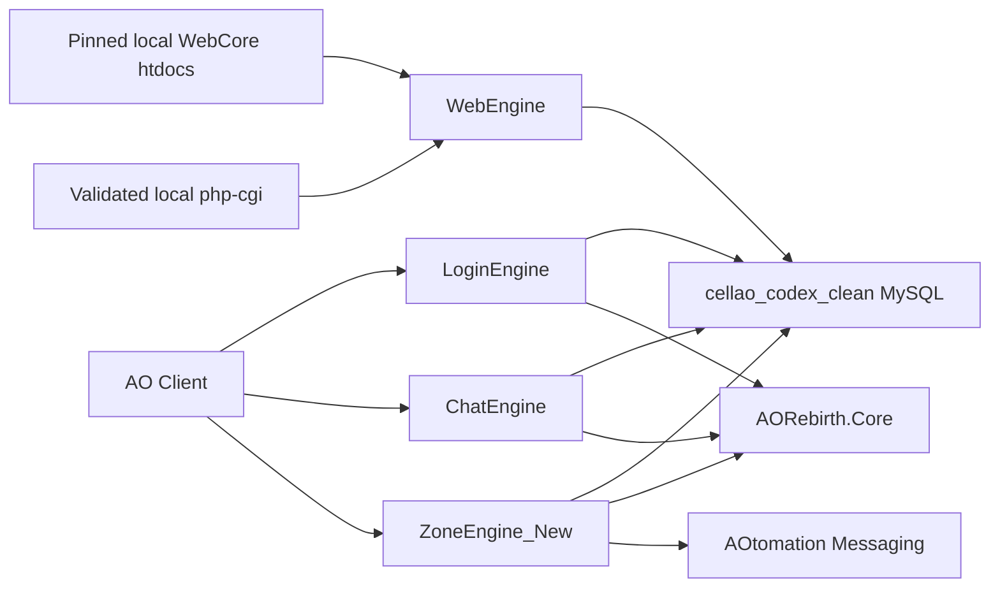
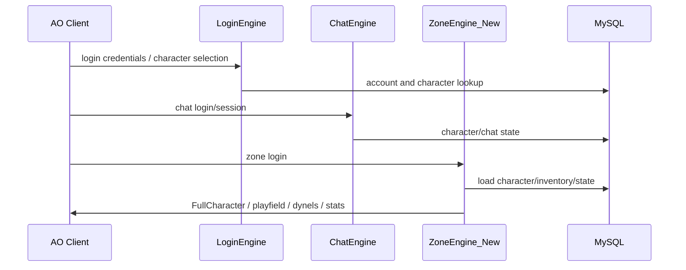
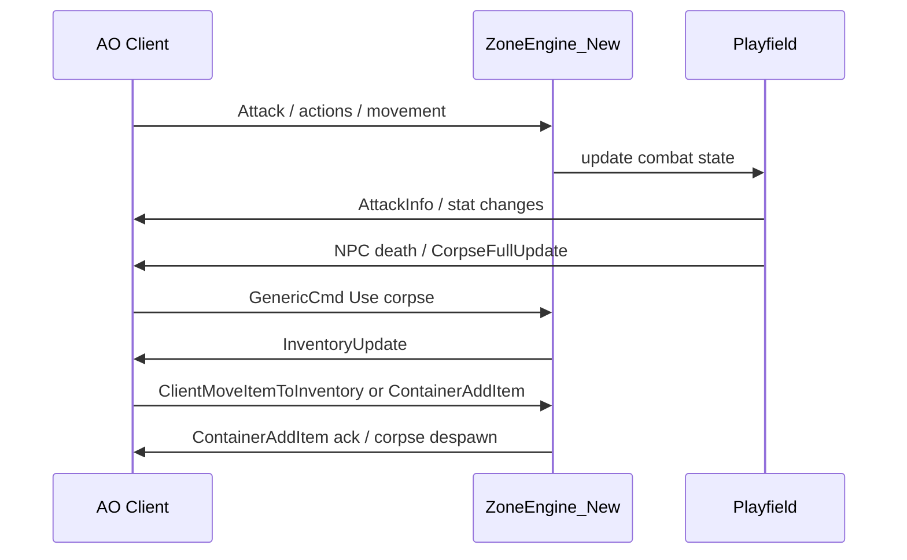
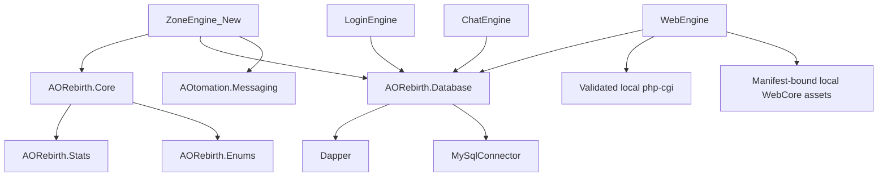

# Architecture

Generated: 2026-06-02

## System Architecture

AO Rebirth is split into console engines plus shared libraries:



## Major Subsystems

- Login: credentials, character list, character creation, selected character handoff.
- Chat: chat sessions, tells, channels, buddy/org structures.
- Zone: playfield entry, character state, movement, combat, inventory, equipment, trade, NPCs, corpses, loot, stat updates, commands, teleporting, and packet responses.
- Core: entities, dynels, characters, inventory pages, items, requirements, functions, vectors, playfields, NPC/vendor handling.
- Database: DAO/entity layer for accounts, characters, items, templates, mobs, loot, and related persisted data.
- Messaging: AOtomation N3 messages and serializers.
- Tools: capture, replay, smoke tests, client hook/injector experiments, and historical utilities.

## Data-oriented gameplay

Retail evidence establishes content and protocol behavior. Editable GameData
holds the selected gameplay definitions, reference pools and tunable policies.
Loaders validate inputs and resolve their references. Runtime components use the
validated definitions through typed interfaces and existing item, persistence,
combat and network services. Preserve hot-path costs by reusing validated data
and eligibility indexes. Fail with a specific diagnostic when a required input
is missing, invalid or unsupported.

### Gameplay modules and DAO ownership

ZoneEngine owns transport, authenticated sessions, dispatch, dependency
injection, scheduling and communication with the other engines. The
composition root binds existing implementations to contracts. Network handlers
adapt messages and dispatch to the responsible module. The gameplay module
owns action eligibility, mechanics and orchestration.

| Boundary | Owner and contract |
| --- | --- |
| Terminal roll transport | `QuestAlternativeMessageHandler` dispatches `QuestAlternativeMessage` through `IMissionTerminalModule`. |
| Terminal roll workflow | `MissionTerminalModule` validates the request and terminal interaction and coordinates the existing generator, persistence and response path. |
| Selection and content | `IGeneratedMissionOfferGenerator` selects from the Phase 1 `MissionContent` snapshot and validated destination catalog. Existing mission content owners retain their registered providers and compatibility loaders. |
| Economic transaction | `GeneratedMissionService.PublishOffers` retains the player persistence gate and commit-before-publication behavior. It uses `IGeneratedMissionDao.PublishOffers`. Durable offer identity allocation remains `IGeneratedMissionDao.ReserveIdentities`. |
| SQL and durable state | Existing DAO implementations own connection use and SQL. Gameplay modules depend on their interfaces and the existing transaction services. |
| Other mission lifecycle operations | `QuestService`, `QuestDungeonService` and `AuthoredQuestService` retain objective, acceptance, reconstruction and quest lifecycle ownership. |
| Quest rewards | `IRewardExecutionModule` projects the earned reward and submits it to the existing `IMissionDao` completion transaction. The quest owner retains the player persistence gate and publishes inventory, cleanup and journal events after commit. |
| Client wire | The shared AOtomation messages and serializers retain the original packet contract. The module uses the existing session gateway to send the same responses. |

Terminal rolling is the controlled proof of this boundary. It uses the
existing in-process dependency injection, mission generator and DAO. Future
gameplay extraction proceeds through the owning module's narrow interface.
Other consumers use that interface or approved shared infrastructure. Keep
native engine-module contracts within their existing runtime; the external
module host and plugin lifecycle continue to serve their existing role.

The architecture guard compares the exact base and proposal to detect new
raw database access, competing persistence abstractions, concrete DAO
coupling, transaction-owner bypasses, handler gameplay and unauthorized
module dependencies. Its existing GameData and content rules remain in
force. Mutation tests exercise these boundaries, while the mission regression
tests check actual selection, packets and transaction behavior. The static
guard identifies recognized source patterns. Indirect calls, transaction
semantics and new shared contracts also require source review.

Quest completion uses the assignment identity in the existing reward ledger.
Its durable stats, items, supported virtual stat writes and research mutation
share the completion transaction. Follow-up quest assignment consumes a pending
stage from that same ledger in the transaction that assigns the child and
grants its starter items. Transient notifications follow a known commit.
Uncertain outcomes require authoritative reload. Keep other virtual OnUse
actions on the existing immediate path until their owning services can provide
transactional or idempotent execution.

### GameData provider

The Zone composition root uses the existing GameData root and override settings
through one GameDataContentProvider. A content module declares its ID, schema
version, owned paths, required inputs, permitted file overrides and dependencies.
The provider resolves declared paths, hashes the exact bytes it passes to the
validator and captures typed dependency snapshots. It rejects duplicate ownership
and unresolved or cyclic dependencies. A slot publishes a complete immutable
value and its metadata together. Readers keep the previous value until a reload
has validated successfully.

Snapshot identity binds module/schema, paths, source selection, file hashes and
dependency identities. Repository/revision metadata is optional and requires a
trusted input from composition. The runtime records bytes even when it lacks a
trusted repository binding. An allowed override supersedes the base file when
present. A bad selected file fails validation. Optional absence is represented
explicitly, separately from a failed read or parse.

MissionRoll owns the typed offers, roll policy, levels and level rules, type and
reward observations, text, geography, and both destination files. MissionKeys
owns the key policy and validates its roles against the existing item template
catalog. Phase 1 keeps these two modules on the startup-selected root to
preserve their existing override behavior. Startup reports both identities.
Accepted mission definitions and their serialization remain owned by the
existing persistence and protocol contracts.

The registry also declares current ownership of dungeon profiles/room
metadata, item and NPC templates, terminal item reward assets, authored quest
packs, QuestRewards and RK chest loot. Their compatibility adapters retain the
existing loaders, validation and source selection. Dependency metadata calls
out a compatibility owner separately from a validated provider snapshot.
Conversion of these adapters is outside the Phase 1 migration.

Mission offer construction, destination selection, objective resolution, quest
persistence and dungeon materialization have separate owners. Offers use the
typed `Missions/MissionOffers.json` definitions and the existing AO serializers.
Capture evidence and raw wire bodies belong in offline analysis or test fixtures.
An accepted offer may still retain its own serialized representation for durable
reconstruction. That representation comes from the generated offer.

`DungeonGeneration.json` supplies new dungeon profiles, objective and NPC pools,
and chest rules. Its `ContentCoverage` describes gaps by role. A provisional
entry names the missing evidence in `Gap`. A completeness claim requires
supporting `Evidence` and an eligible pool beyond the single-choice prototypes.
Keep evidence limits visible in content review and validation reports.

The exact version 1/2 seed-only layout parameters are compatibility inputs for
accepted missions. They originate in commit
`8f517d711f6208c3308c06c68b414fd59a1316df`. The guard checks the values, version
gate and references to those fields. The architecture mutation tests reject
changes that broaden the gate. `ProceduralDungeonFoundationTests.PreviouslyAcceptedV2SeedsKeepExactGeneratorPayloadAndSpawnBits`
checks version 2 against `Fixtures/ProceduralDungeonV2Golden.json`.

The existing Roslyn runtime content guard provides two proposed-change modes.
On Windows, run `Tools/run_newengine_content_architecture_guard.cmd --doa-self-test`
for focused mutation cases and `Tools/run_newengine_content_architecture_guard.cmd
--enforce <base-sha>` for the change check. Supply the exact Git base of the
proposal. Optionally add `--catalog-root <GameData>` for authoritative mission
item and NPC family resolution and `--output <report>` for structured findings.
Keep private catalog output in the owning ignored workspace.

The CI workflow applies the source graph and public catalog checks on pull
requests and relevant pushes. The check rejects new findings and newly
unresolved project inputs. It inventories inherited findings separately by
path, rule, syntax fingerprint and occurrence count. A moved, edited or copied
violation cannot reuse an inherited occurrence. Treat inherited findings as
remediation work. The existing full-inventory modes retain their report contract.

Public CI can check catalog structure, recorded payload fields and declarations
of coverage. Authoritative private hash references require the selected
GameData. Production loaders and targeted tests validate the actual item
definitions and typed protocol fields. The Roslyn checks cover documented source
patterns and the existing project graph inventory. Semantic review remains
required for new APIs and indirect flows outside those patterns.

The existing `content-boundary` job also runs the runtime catalog contract.
The contract compares fixed `GameDataPaths.ResolveFile` dependencies and PORK
catalog declarations with the exact PR base. A newly discovered dependency needs
runtime admission, a schema contract, and a focused production reader fixture.
The public fixture executes the production Legacy PvP loader using synthetic
content. The job identifies which changes require private review.

Before merging a change flagged for private review, an authorized maintainer
reviews the exact proposed source and runs the existing catalog contract from a
clean candidate checkout. Use the owning product checkout for the private
profile and run storage preflight before the focused .NET validation.

```text
python -B Tools/runtime_catalog_contract.py --base <exact-public-base> --expected-source <reviewed-head> --authority-root <PUBLIC_PRODUCT_CHECKOUT>
```

The command checks the authenticated current upstream and the selected canonical
manifest, reports missing or unreconciled catalogs by path, and runs the real
PHP PORK, Legacy PvP and NPC encounter readers. For new catalog bytes still
awaiting governed reconciliation, pass `--catalog-root` with a private staged
selection inside the owning profile's ignored state root. Keep the selected
GameData, logs and exact source/content/manifest receipt in that private state.
Run the check again if the source, content or selected manifest changes before
merge. Public CI receives no private input or private validation credentials.

## Data Flow

Typical login/playfield flow:



Typical combat/loot flow:



## Class And Module Structure

Important files and directories:

- `AORebirth/Libraries/Source/AORebirth.Core/Entities/Dynel.cs`: base dynamic entity.
- `AORebirth/Libraries/Source/AORebirth.Core/Entities/Character.cs`: character model.
- `AORebirth/Libraries/Source/AORebirth.Core/Inventory`: inventory pages and item movement models.
- `AORebirth/Server/ZoneEngine_New/Core/Entities/Player.cs`: player runtime entity and state.
- `AORebirth/Server/ZoneEngine_New/Core/Entities/NpcCharacter.cs`: NPC runtime entity.
- `AORebirth/Server/ZoneEngine_New/Core/Ai/NpcBrain.cs`: reusable NPC behavior.
- `AORebirth/Server/ZoneEngine_New/Core/Movement/CharacterMotor.cs`: server movement authority and vehicle-simulation integration.
- `AORebirth/Server/ZoneEngine_New/Core/GameData/NpcTemplateCatalog.cs` and `PlayfieldNpcContentCatalog.cs`: validated editable NPC and playfield content loading.
- `AORebirth/Server/ZoneEngine_New/Core/Mobs/NpcContentActivationService.cs` and `WorldNpcFactory.cs`: NPC content activation and runtime construction.
- Historical retired-ZoneEngine provenance: `docs/reference/pf4582/PlayfieldDistrictInfo.json`, `Tools/generate_pf4582_placements.py`, and the retired `IccShuttleportPlacementCatalog*.cs` targets record PF4582's 206-placement evidence, deterministic normalization, and source-key mapping. Those generated-C# targets are not `ZoneEngine_New` inputs. `NpcId` is the stable AORebirth placement key, not a proven native Funcom field. `template-hash-evidence.json` and `Tools/audit_pf4582_template_hashes.py` provide the separate pinned 38-key identity-resolution ledger; the legacy `TemplateHash` name does not imply a terminal mob identity.
- Historical retired-ZoneEngine provenance: `docs/reference/pf4582/official/`, `Tools/reconcile_pf4582_official_source.py`, and the retired `IccShuttleportOfficialPlacementCatalog*.cs` targets retain byte-pinned official EP1 structural evidence and 206-to-207 reconciliation. Those generated-C# targets are not `ZoneEngine_New` inputs. The official `HashSpawnPoint_t` parser and packed four-byte `ACGHash_t` scalar/tag are proven; terminal identity remains unresolved. The retired baseline was 25 active / 181 blocked, and `NCNN` had null `SourceNpcId`.
- `Tools/import_official_playfield_placements.py`, `docs/reference/playfields/official-placement-source-manifest.json`, and `docs/generated/playfields/`: normalized official placement evidence for tooling and tests. `OfficialPlayfieldPlacementCatalog` validates that evidence but is not compiled into or consumed by `ZoneEngine_New`.
- `AORebirth/Server/ZoneEngine_New/Core/Playfield/Playfield.cs`: world and playfield orchestration — **do not add new system ecosystems here**; extract reusable mechanics to `Core/<System>/` (see `docs/project/SUBSYSTEMS.md`).
- `AORebirth/Server/ZoneEngine_New/Core/Knubot/`, `Missions/`, and `Inventory/`: current gameplay-system owners.
  Knubot NPC conversations are data in `GameData/Knubot/**/*.json`.
- `AORebirth/Server/ZoneEngine_New/Core/Network/` and `MessageHandlers/`: zone networking and thin message dispatch.
- `AORebirth/Server/ZoneEngine_New/Core/Commands/`: command surface.
- `AORebirth/Libraries/Source/AOtomation/AOtomation.Messaging`: message models and serializer contracts.

## Networking Architecture

The project uses N3/AOtomation message models for client/server packet flow. Important packet families from current work:

- `Action = 0x2049527C`
- `Attack = 0x28494070`
- `CharacterAction = 0x5E477770`
- `ContainerAddItem = 0x47537A24`
- `InventoryUpdate = 0x4E536976`
- `InventoryUpdated = 0x485E7202`
- `SimpleItemFullUpdate = 0x3B11256F`
- `TemplateAction = 0x35505644`
- `WeaponItemFullUpdate = 0x3B1D2268`

Packet repairs must distinguish:

- AOtomation model shape.
- Captured runtime envelope shape.
- AO stripdown recovered subclass body.
- Current-client live behavior.

## Database Architecture

The local configuration is MySQL and must use only `cellao_codex_clean`. The project includes DAO/entity code under `AORebirth/Libraries/Source/AORebirth.Database`. Do not infer schema safety from code alone; data mutation requires explicit project-owner approval when destructive or broad.

## Asset Pipeline

The repo contains logos, XML data files, documentation generated from enums/stats, and tooling. Client assets come from the installed AO client and external reverse-engineered sources. There is no single build-time pipeline for all of these assets.

Optional WebEngine has two offline, fail-closed supply boundaries. The PHP
boundary pins an official PHP 8.5.9 Windows x64 NTS VS17 archive, full file
inventory, AORebirth `php.ini`, runtime probes, and a process-lifetime lease.
The content boundary pins the exact CellAO WebCore commit
`765c3850767b63af1cd259bab7f2f7ca3e97adf9`, validates its untouched 7,140-file
base tree, applies seven exact input-hash-bound compatibility operations, and
validates a complete final 7,140-file manifest before activation. Runtime
startup downloads or updates neither dependency. `WebRequestPathPolicy` exposes
only four public PHP routes and allowlisted static extensions; historical
admin/internal/authentication/mutation routes fail closed. See
`docs/project/WEBCORE_ASSET_SUPPLY.md` and
`docs/project/PHP_RUNTIME_SUPPLY.md`.

## UI Architecture

The project itself has console engines and no modern app UI. AO client UI behavior is driven by packet responses. Player trade windows, loot windows, equipment visuals, death screen behavior, and NPC movement visuals are client UI effects triggered by server packet flow.

## Build Architecture

Primary build:

```cmd
cmd /d /c tools\build_aorebirth_debug.cmd
```

The standard validation wrapper verifies required package folders before MSBuild, runs explicit MSBuild solution restore only when package folders are missing, then builds `AORebirth.Core`, `ZoneEngine_New`, the read-only `DatabasePreflight`, and `WebEngine` with single-node MSBuild (`/m:1`) and node reuse disabled (`/nr:false`). Legacy build-time NuGet restore through `.nuget\NuGet.targets` has been removed from project files. PowerShell and `.ps1` wrappers are implementation details behind approved CMD lifecycle entrypoints and are not invoked directly by Codex. The solution includes server engines, shared libraries, AOtomation, msgpack-cli, and utility projects. Some tools under `tools-temp` are separate projects and are not necessarily part of the main solution.

## Dependency Graph

High-level dependency direction:



## Architectural Concerns

- `Playfield.cs` is a large god object and owns many unrelated systems.
- Packet behavior is split across AOtomation models, handlers, and custom packet builders.
- Some current-client packet contracts differ from old AO Rebirth assumptions.
- Movement and NPC behavior need capture/replay validation before more runtime edits.
- Tests are mostly smoke/source assertions; they are useful but not full simulation coverage.
- WebEngine remains optional and development-only. PHP 8.5.9 identity,
  configuration, CGI execution, required modules, deterministic WebCore repairs,
  and all PHP syntax are validated; live database semantics, HTTPS transport,
  and upstream redistribution rights remain unproven.

## Historical: Retired ZoneEngine Hostile NPC Chase Navigation

This section is retained as historical design evidence and does not describe
the active `ZoneEngine_New` runtime. Current movement and navigation ownership
is in `ZoneEngine_New.Core.Ai.NpcBrain`,
`ZoneEngine_New.Core.Movement.CharacterMotor`, and
`AORebirth.World.Pathfinding`.

Historically, the global navigation boundary was `ZoneEngine.Core.Navigation`, not an enemy or playfield content profile. The combat policy requested pursuit through `PlayfieldNpcCombatMovementRuntimeService`; `NpcChaseNavigationRuntimeService` chose direct movement, a cached provider route, or a fail-closed hold. `IPlayfieldChaseNavigationProvider` supplied authoritative segment checks and route generation without exposing PF127 details to combat code. Valid destinations continued through `NPCController.MoveTo`, preserving server movement cadence and client synchronization.

PF127/resource `127` is currently the only supported provider. It derives a bounded same-elevation grid from the promoted collision geometry and validates every segment against that geometry. Other playfields explicitly remain unsupported and preserve legacy direct chase. See `docs/project/NPC_CHASE_NAVIGATION.md` for exact limits, failure behavior, lifecycle cleanup, validation, and the provider-adoption process.
