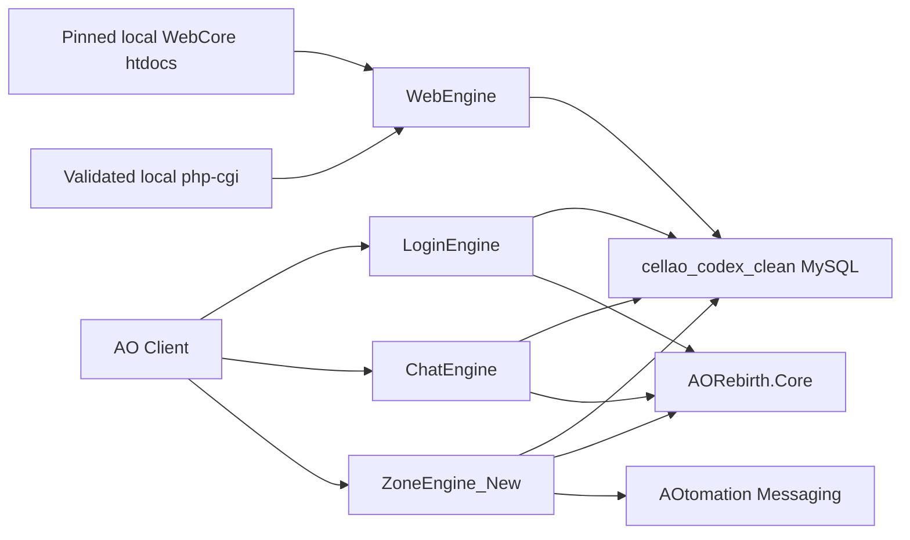
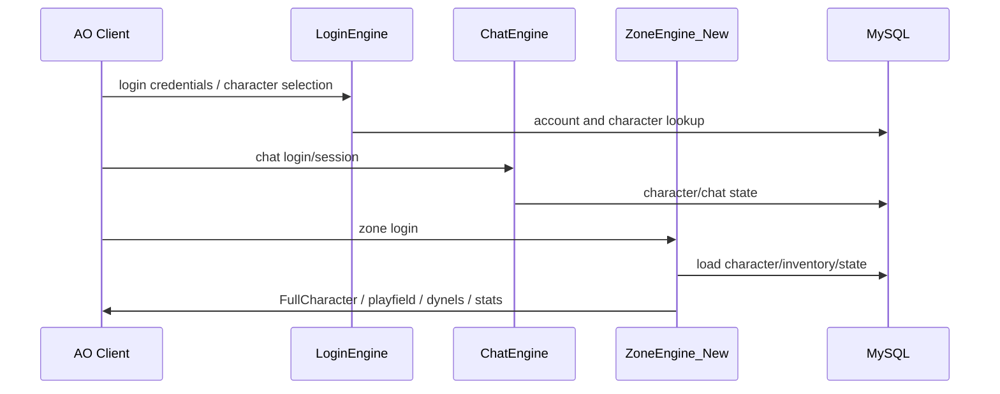
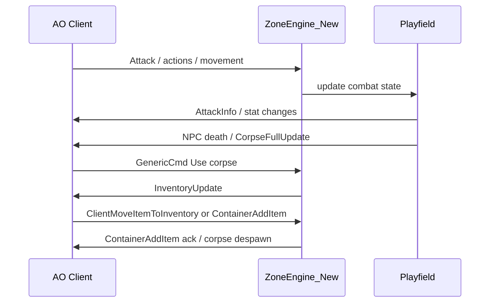
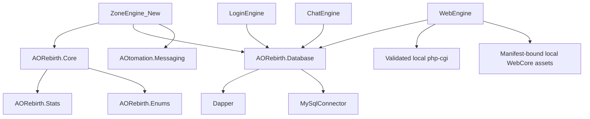

# Architecture

Generated: 2026-06-02

## System Architecture

AO Rebirth is split into console engines plus shared libraries:



## Major Subsystems

- Login: credentials, character list, character creation, selected character handoff.
- Chat: chat sessions, tells, channels, buddy/org structures.
- Zone: playfield entry, character state, movement, combat, inventory, equipment, trade, NPCs, corpses, loot, stat updates, commands, teleporting, and packet responses.
- Core: entities, dynels, characters, inventory pages, items, requirements, functions, vectors, playfields, NPC/vendor handling.
- Database: DAO/entity layer for accounts, characters, items, templates, mobs, loot, and related persisted data.
- Messaging: AOtomation N3 messages and serializers.
- Tools: capture, replay, smoke tests, client hook/injector experiments, and historical utilities.

## Data-oriented gameplay

Retail evidence establishes content and protocol behavior. Editable GameData
holds the selected gameplay definitions, reference pools and tunable policies.
Loaders validate inputs and resolve their references. Runtime components use the
validated definitions through typed interfaces and existing item, persistence,
combat and network services. Preserve hot-path costs by reusing validated data
and eligibility indexes. Fail with a specific diagnostic when a required input
is missing, invalid or unsupported.

Mission offer construction, destination selection, objective resolution, quest
persistence and dungeon materialization have separate owners. Offers use the
typed `Missions/MissionOffers.json` definitions and the existing AO serializers.
Capture evidence and raw wire bodies belong in offline analysis or test fixtures.
An accepted offer may still retain its own serialized representation for durable
reconstruction. That representation comes from the generated offer.

`DungeonGeneration.json` supplies new dungeon profiles, objective and NPC pools,
and chest rules. Its `ContentCoverage` describes gaps by role. A provisional
entry names the missing evidence in `Gap`. A completeness claim requires
supporting `Evidence` and an eligible pool beyond the single-choice prototypes.
Keep evidence limits visible in content review and validation reports.

The exact version 1/2 seed-only layout parameters are compatibility inputs for
accepted missions. They originate in commit
`8f517d711f6208c3308c06c68b414fd59a1316df`. The guard checks the values, version
gate and references to those fields. The architecture mutation tests reject
changes that broaden the gate. `ProceduralDungeonFoundationTests.PreviouslyAcceptedV2SeedsKeepExactGeneratorPayloadAndSpawnBits`
checks version 2 against `Fixtures/ProceduralDungeonV2Golden.json`.

On Windows, run `Tools/run_newengine_content_architecture_guard.cmd --doa-self-test`
for deterministic mutation tests. Run the same wrapper with
`--enforce-structure <base-sha>` for the public source and catalog check and
`--enforce <base-sha> --catalog-root <GameData>` to include authoritative
references. For both checks, use `Build-Package.cmd --graph-output <directory>`
under `Tools/AOClientRoomSpaceGuard/ProxyDll` and pass its compiler evidence
directory as `--native-graph <directory>`. Both modes accept `--output <report>`.
Supply the exact Git base.
Keep reports containing private content in the owning ignored workspace.

Both checks reject every current architecture finding and unresolved required
project input. The baseline identifies inherited findings for remediation. It
has no effect on acceptance. Public pull-request CI reports its structural
result as `dao-runtime-structure`.

Integration also requires `dao-canonical-validation` from a trusted private
validator. Bind its result to the exact candidate and current base, the approved
private upstream revision, and the canonical GameData manifest. The validator
must resolve required references and exercise affected production loaders,
eligibility checks, and serialization and persistence contracts. Publish only
the status and a reference to restricted evidence. Keep private data and status
publication credentials outside candidate-controlled jobs. Missing or
inconclusive private evidence blocks integration.

### Trusted validation and master protection

Use the private validation workflow from its independently reviewed, pinned
workflow commit. Stage the approved canonical content before executing the
candidate. Use an isolated validation worker with access limited to the staged
data and disposable dependencies. Keep network publication credentials and
private upstream credentials on the trusted controller, outside that worker.

The pinned workflow runs a job named `dao-canonical-validation`. The job must
complete each named validation step in `tools/dao_canonical_publisher.py` and
upload `dao-canonical-evidence-<run_attempt>` with the actual canonical
`manifest.json` and its `receipt.json`. The receipt schema in `verify_receipt`
binds the measured source, current base, current private revision and tree,
manifest hash, run attempt, and successful checks. Build the manifest with the
existing release-contract inventory algorithm. A complete manifest and passing
runtime evidence are required even when the public structural check passes.

Use the existing focused Zone tests with `-p:DaoCanonicalRuntimeLoaderTests=true`
and the focused Chat tests with `-p:ChatNetworkFocusedTests=true` and
`--filter TestCategory=DaoCanonicalChatLoaders`. Set `DAO_CANONICAL_GAMEDATA_ROOT`
to the absolute path of the measured tree. Require every selected loader test to
execute and pass. Use the disposable schema validation workflow for the actual
schema and retain its measured result alongside the schema contract tests.

Use an independently reviewed checkout of the publisher on the trusted
controller. Bind `DAO_TRUSTED_VALIDATOR` in its ignored profile
to the private `REPOSITORY`, numeric `WORKFLOW_ID`, pinned `WORKFLOW_SOURCE_SHA`,
numeric installed `APP_ID` and `MASTER_RULESET_ID`. Set the short-lived App
installation token in `AO_REBIRTH_DAO_APP_TOKEN` only for the controller process.
The App needs Checks write access on the public repository. Run
`Tools/publish_dao_canonical_validation.cmd --profile <ignored-profile> --candidate <exact-sha> --private-run <run-id>`.
The publisher checks the authenticated run attempt and job steps, verifies the
archive digest and manifest, checks current source and content authority, and
publishes success only through the App bound to the active `master` ruleset.
Only the source and the evidence digest appear in the public check.

Keep the temporary `update` restriction in the active `master` ruleset while
trusted validation is unavailable or failing. Once all required checks pass on
the exact proposed commit and current base, read the active ruleset and verify
that its required status contexts are source-bound, strict status checking is
enabled, the pull request rule applies, and the bypass actor list is empty.
Then remove only the temporary `update` rule in a reviewed settings change.
Re-read the effective rules on `master` and verify that both checks, the pull
request rule, and the deletion and force-push protections are still active.
If any verification fails, retain or restore the update restriction.

## Data Flow

Typical login/playfield flow:



Typical combat/loot flow:



## Class And Module Structure

Important files and directories:

- `AORebirth/Libraries/Source/AORebirth.Core/Entities/Dynel.cs`: base dynamic entity.
- `AORebirth/Libraries/Source/AORebirth.Core/Entities/Character.cs`: character model.
- `AORebirth/Libraries/Source/AORebirth.Core/Inventory`: inventory pages and item movement models.
- `AORebirth/Server/ZoneEngine_New/Core/Entities/Player.cs`: player runtime entity and state.
- `AORebirth/Server/ZoneEngine_New/Core/Entities/NpcCharacter.cs`: NPC runtime entity.
- `AORebirth/Server/ZoneEngine_New/Core/Ai/NpcBrain.cs`: reusable NPC behavior.
- `AORebirth/Server/ZoneEngine_New/Core/Movement/CharacterMotor.cs`: server movement authority and vehicle-simulation integration.
- `AORebirth/Server/ZoneEngine_New/Core/GameData/NpcTemplateCatalog.cs` and `PlayfieldNpcContentCatalog.cs`: validated editable NPC and playfield content loading.
- `AORebirth/Server/ZoneEngine_New/Core/Mobs/NpcContentActivationService.cs` and `WorldNpcFactory.cs`: NPC content activation and runtime construction.
- Historical retired-ZoneEngine provenance: `docs/reference/pf4582/PlayfieldDistrictInfo.json`, `Tools/generate_pf4582_placements.py`, and the retired `IccShuttleportPlacementCatalog*.cs` targets record PF4582's 206-placement evidence, deterministic normalization, and source-key mapping. Those generated-C# targets are not `ZoneEngine_New` inputs. `NpcId` is the stable AORebirth placement key, not a proven native Funcom field. `template-hash-evidence.json` and `Tools/audit_pf4582_template_hashes.py` provide the separate pinned 38-key identity-resolution ledger; the legacy `TemplateHash` name does not imply a terminal mob identity.
- Historical retired-ZoneEngine provenance: `docs/reference/pf4582/official/`, `Tools/reconcile_pf4582_official_source.py`, and the retired `IccShuttleportOfficialPlacementCatalog*.cs` targets retain byte-pinned official EP1 structural evidence and 206-to-207 reconciliation. Those generated-C# targets are not `ZoneEngine_New` inputs. The official `HashSpawnPoint_t` parser and packed four-byte `ACGHash_t` scalar/tag are proven; terminal identity remains unresolved. The retired baseline was 25 active / 181 blocked, and `NCNN` had null `SourceNpcId`.
- `Tools/import_official_playfield_placements.py`, `docs/reference/playfields/official-placement-source-manifest.json`, and `docs/generated/playfields/`: normalized official placement evidence for tooling and tests. `OfficialPlayfieldPlacementCatalog` validates that evidence but is not compiled into or consumed by `ZoneEngine_New`.
- `AORebirth/Server/ZoneEngine_New/Core/Playfield/Playfield.cs`: world and playfield orchestration — **do not add new system ecosystems here**; extract reusable mechanics to `Core/<System>/` (see `docs/project/SUBSYSTEMS.md`).
- `AORebirth/Server/ZoneEngine_New/Core/Knubot/`, `Missions/`, and `Inventory/`: current gameplay-system owners.
  Knubot NPC conversations are data in `GameData/Knubot/**/*.json`.
- `AORebirth/Server/ZoneEngine_New/Core/Network/` and `MessageHandlers/`: zone networking and thin message dispatch.
- `AORebirth/Server/ZoneEngine_New/Core/Commands/`: command surface.
- `AORebirth/Libraries/Source/AOtomation/AOtomation.Messaging`: message models and serializer contracts.

## Networking Architecture

The project uses N3/AOtomation message models for client/server packet flow. Important packet families from current work:

- `Action = 0x2049527C`
- `Attack = 0x28494070`
- `CharacterAction = 0x5E477770`
- `ContainerAddItem = 0x47537A24`
- `InventoryUpdate = 0x4E536976`
- `InventoryUpdated = 0x485E7202`
- `SimpleItemFullUpdate = 0x3B11256F`
- `TemplateAction = 0x35505644`
- `WeaponItemFullUpdate = 0x3B1D2268`

Packet repairs must distinguish:

- AOtomation model shape.
- Captured runtime envelope shape.
- AO stripdown recovered subclass body.
- Current-client live behavior.

## Database Architecture

The local configuration is MySQL and must use only `cellao_codex_clean`. The project includes DAO/entity code under `AORebirth/Libraries/Source/AORebirth.Database`. Do not infer schema safety from code alone; data mutation requires explicit project-owner approval when destructive or broad.

## Asset Pipeline

The repo contains logos, XML data files, documentation generated from enums/stats, and tooling. Client assets come from the installed AO client and external reverse-engineered sources. There is no single build-time pipeline for all of these assets.

Optional WebEngine has two offline, fail-closed supply boundaries. The PHP
boundary pins an official PHP 8.5.9 Windows x64 NTS VS17 archive, full file
inventory, AORebirth `php.ini`, runtime probes, and a process-lifetime lease.
The content boundary pins the exact CellAO WebCore commit
`765c3850767b63af1cd259bab7f2f7ca3e97adf9`, validates its untouched 7,140-file
base tree, applies seven exact input-hash-bound compatibility operations, and
validates a complete final 7,140-file manifest before activation. Runtime
startup downloads or updates neither dependency. `WebRequestPathPolicy` exposes
only four public PHP routes and allowlisted static extensions; historical
admin/internal/authentication/mutation routes fail closed. See
`docs/project/WEBCORE_ASSET_SUPPLY.md` and
`docs/project/PHP_RUNTIME_SUPPLY.md`.

## UI Architecture

The project itself has console engines and no modern app UI. AO client UI behavior is driven by packet responses. Player trade windows, loot windows, equipment visuals, death screen behavior, and NPC movement visuals are client UI effects triggered by server packet flow.

## Build Architecture

Primary build:

```cmd
cmd /d /c tools\build_aorebirth_debug.cmd
```

The standard validation wrapper verifies required package folders before MSBuild, runs explicit MSBuild solution restore only when package folders are missing, then builds `AORebirth.Core`, `ZoneEngine_New`, the read-only `DatabasePreflight`, and `WebEngine` with single-node MSBuild (`/m:1`) and node reuse disabled (`/nr:false`). Legacy build-time NuGet restore through `.nuget\NuGet.targets` has been removed from project files. PowerShell and `.ps1` wrappers are implementation details behind approved CMD lifecycle entrypoints and are not invoked directly by Codex. The solution includes server engines, shared libraries, AOtomation, msgpack-cli, and utility projects. Some tools under `tools-temp` are separate projects and are not necessarily part of the main solution.

## Dependency Graph

High-level dependency direction:



## Architectural Concerns

- `Playfield.cs` is a large god object and owns many unrelated systems.
- Packet behavior is split across AOtomation models, handlers, and custom packet builders.
- Some current-client packet contracts differ from old AO Rebirth assumptions.
- Movement and NPC behavior need capture/replay validation before more runtime edits.
- Tests are mostly smoke/source assertions; they are useful but not full simulation coverage.
- WebEngine remains optional and development-only. PHP 8.5.9 identity,
  configuration, CGI execution, required modules, deterministic WebCore repairs,
  and all PHP syntax are validated; live database semantics, HTTPS transport,
  and upstream redistribution rights remain unproven.

## Historical: Retired ZoneEngine Hostile NPC Chase Navigation

This section is retained as historical design evidence and does not describe
the active `ZoneEngine_New` runtime. Current movement and navigation ownership
is in `ZoneEngine_New.Core.Ai.NpcBrain`,
`ZoneEngine_New.Core.Movement.CharacterMotor`, and
`AORebirth.World.Pathfinding`.

Historically, the global navigation boundary was `ZoneEngine.Core.Navigation`, not an enemy or playfield content profile. The combat policy requested pursuit through `PlayfieldNpcCombatMovementRuntimeService`; `NpcChaseNavigationRuntimeService` chose direct movement, a cached provider route, or a fail-closed hold. `IPlayfieldChaseNavigationProvider` supplied authoritative segment checks and route generation without exposing PF127 details to combat code. Valid destinations continued through `NPCController.MoveTo`, preserving server movement cadence and client synchronization.

PF127/resource `127` is currently the only supported provider. It derives a bounded same-elevation grid from the promoted collision geometry and validates every segment against that geometry. Other playfields explicitly remain unsupported and preserve legacy direct chase. See `docs/project/NPC_CHASE_NAVIGATION.md` for exact limits, failure behavior, lifecycle cleanup, validation, and the provider-adoption process.
